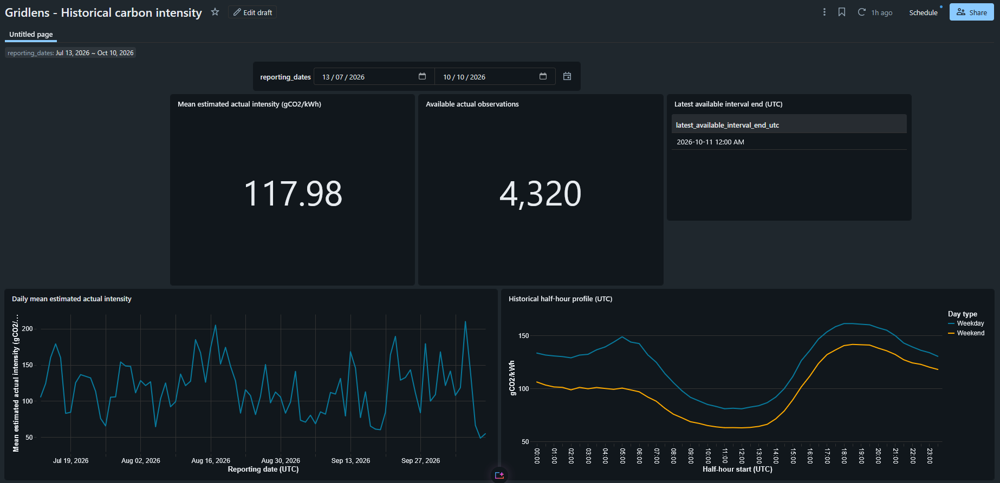
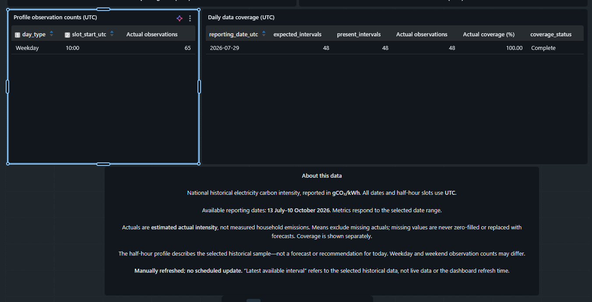
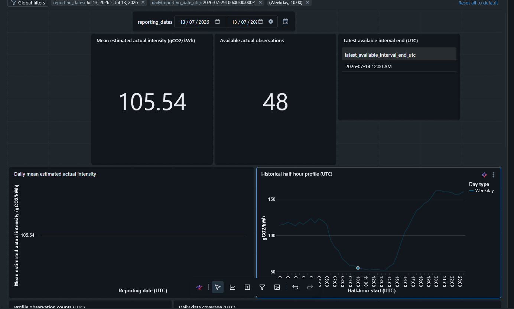

# GridLens

**A manually run Databricks pipeline and historical dashboard for exploring Great Britain’s electricity carbon intensity.**

GridLens ingests data from the [Carbon Intensity API](https://www.carbonintensity.org.uk/), retains raw request evidence, validates and reconciles interval records, and presents a selected historical window in a Databricks AI/BI dashboard.

> **Project status:** This repository contains reviewed source exports and historical results. The notebooks were manually executed in Databricks. Clean-install reproduction has not been independently verified, and the dashboard is not published here as a live service.

## Dashboard

### Full reporting range



### Coverage and details



### Single-day example



## Architecture

```text
National Carbon Intensity API
        ↓
Bronze: raw request-attempt responses and provenance
        ↓
Silver: validated, deduplicated, revision-aware intervals
        ↓
Dashboard SQL over Silver
        ↓
Historical Databricks AI/BI dashboard
```

The dashboard queries Silver directly. **No Gold tables or views were created.**

## What the pipeline does

- Retrieves national historical data in bounded request windows.
- Appends raw API response bodies and request/attempt provenance to Bronze.
- Parses and validates records before selecting interval winners.
- Uses the latest valid retrieval when handling revisions.
- Preserves missing estimated actual values as null; forecasts do not replace actuals.
- Reports interval presence separately from actual-value coverage.
- Provides three parameterised dashboard datasets: overview, daily intensity, and weekday/weekend half-hour profile.

## Verified results

For the selected reporting window **13 July–10 October 2026 inclusive (UTC)**:

- Seven API request windows completed successfully for the configured backfill.
- Bronze contained 4,327 raw records: 4,320 selected interval records, six duplicate losers, and one out-of-range record.
- Silver contained **4,320 unique half-hour intervals**, with no missing or unexpected keys in the verified window.
- Interval presence and non-null estimated-actual coverage were both **100% for this selected backfill**.
- The dashboard’s full-window mean was approximately **117.98 gCO₂/kWh** across 4,320 observations.
- The 13 July single-day view showed a mean of **105.54 gCO₂/kWh** across 48 observations.

These results describe the verified historical sample only; they do not guarantee completeness for future API responses.

## Repository contents

```text
.
├── README.md
├── assets/
│   ├── dashboard_coverage.png
│   ├── dashboard_full_range.png
│   └── dashboard_single_day.png
├── notebooks/
│   ├── 00_environment_check.py
│   ├── 01_source_ingestion.py
│   ├── 02_ingestion_verification.py
│   ├── 03_validated_delta_model.py
│   └── 04_delta_model_verification.py
├── sql/
│   ├── daily_intensity.sql
│   ├── overview.sql
│   └── time_of_day_profile.sql
└── supplementary/
    ├── 05_runtime_ingestion.py
    ├── 06_runtime_silver.py
    ├── 07_fixture_job_ingestion.py
    ├── 08_10_runtime_additions.py
    └── 08_fixture_job_silver.py
```

The supplementary runtime and fixture-job scripts are not part of the main five-notebook execution sequence.

## Running in Databricks

These are Databricks notebook source exports, not a standalone local application. The verified workflow used Databricks notebook compute with access to the `workspace` catalog and the permissions needed for the Bronze and Silver tables. The recorded environment was Python 3.12.3 and Spark 4.2.0; compatibility with other runtimes has not been established.

The API is public and does not require credentials. Network access from Databricks is needed for live ingestion.

1. Import or open the notebooks in a Databricks workspace.
2. Review `00_environment_check.py` and confirm the target catalog, permissions, runtime, and source reachability.
3. Run `01_source_ingestion.py` in stages. Review its configuration and live-write approval guards before enabling persistent writes.
4. Run `02_ingestion_verification.py` against the intended persisted run evidence.
5. Run `03_validated_delta_model.py` in its documented order. It contains stateful stages and guarded writes; do not blindly run the entire notebook or manually force its pass flags.
6. Run `04_delta_model_verification.py` for independent, read-only checks of the persisted model.
7. To reproduce the dashboard datasets, run the SQL files in `sql/` in Databricks and configure a shared date-range parameter named `reporting_dates`.

The notebooks rely on workspace-specific catalog and table configuration. Review their settings and cell-level instructions before execution. The supplied verification expectations refer to the recorded project run; a different range or source run requires updating and reviewing the expected evidence.

## Validation evidence

The project includes controlled tests and disposable Delta-table checks for parsing, validation, revision selection, idempotent reruns, conflict handling, and rejection handling. These tests support the specified behaviours; they do not mean that live source failures or revisions were deliberately induced. Final Silver verification independently checked persisted data against Bronze evidence and the expected UTC interval grid.

## Scope and limitations

- Historical reporting only; ingestion and dashboard refresh were manual.
- No scheduled job, always-on service, production SLA, or public dashboard access is claimed.
- Source actuals are **estimated carbon intensity** in gCO₂/kWh—not measured household emissions.
- Forecast values are not substituted for actuals, and missing values are not treated as zero.
- Completeness applies only to the selected, verified historical window.
- Existing Databricks execution is evidenced; clean-install reproduction has not been independently tested.

## Attribution and AI assistance

Data source: [Carbon Intensity API](https://www.carbonintensity.org.uk/). See the [official API definitions](https://carbon-intensity.github.io/api-definitions/).

Notion AI generated copy-ready notebook code and SQL and helped review returned evidence. The project author copied the code into Databricks, configured the environment, executed the notebooks, and reviewed the results. Notion AI did not directly access or execute work in Databricks.